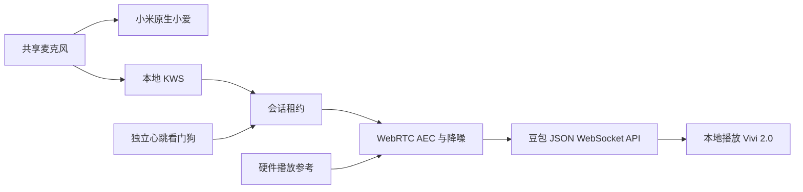

# 设计与分工

## 唤醒和互斥

唤醒模型在音箱上识别“豆包同学”；“小爱同学”仍由原系统处理。`keywords.txt` 内的 `@豆包豆包` 是沿用的内部事件标签，不代表当前用户必须说这四个字。

进入豆包前先获得临时原生唤醒静音租约。豆包会话内不切入小爱；结束后解除租约。原生会话活动后等待约六秒再接受豆包唤醒。看门狗独立于主程序，心跳丢失后恢复原生；它不停止音乐、闹钟或米家服务。

## 音频和连续对话

独立 ALSA 路由从共享采集中取得麦克风 0 和硬件播放参考 3。WebRTC 回声消除及噪声抑制后再做固定增益，避免在回声消除前削波。豆包讲话时继续上传有效麦克风音频，配合服务端识别和本地播放清空实现插话。

录音缓冲 8000 帧，应用处理仍按 20 ms 回调；识别模型先预热，减少启动丢帧。未启用可选的双路降噪唤醒实验路径。

## 生命周期

正常静默等待约 6.2 秒；有效用户输入另有响应等待时间。回答播放时暂停静默倒计时，播放完毕后重新计时。持续有输入、生成或播放进展时不按会话总时长强制结束；60 秒无有效进展作为故障处理。服务端结束先排空已收到的音频。

事件日志只读取事件类型，文件尚未创建、截断或轮转时继续跟随。后台启动以工作进程 PID 和 ready 标记核对初始化完成状态。

## 边界

本地 KWS 没有复用原生小爱的完整阵列处理和专用唤醒模型，所以远场效果不同。程序不提供米家工具调用；小爱原生控制分工保留。API 或网络故障、播放缓存上限、音箱本身资源与调度限制仍可能影响交互。
